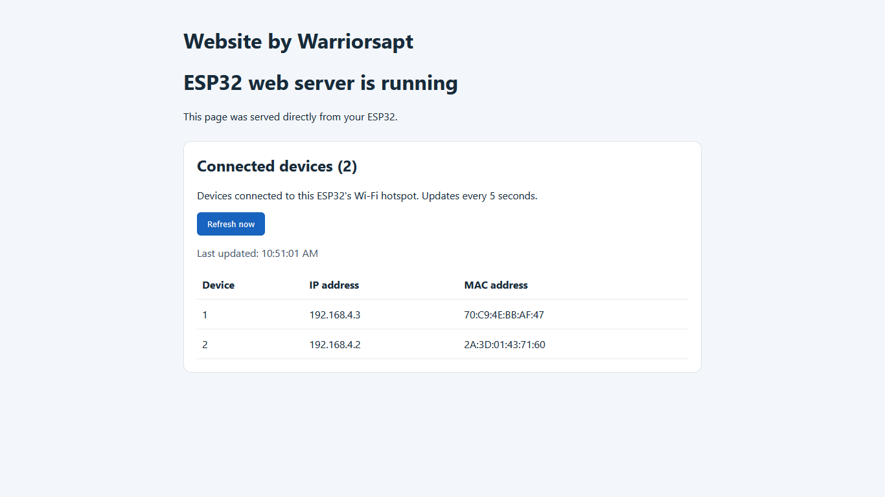

# ESP32 Web Test

PlatformIO firmware for an ESP32 Wi-Fi hotspot with internet sharing and a web page listing connected devices.

The Wi-Fi overview dashboard shows live hotspot and router metrics and refreshes every five seconds, with a manual refresh option.

- Summary cards for connected clients, access point/SSID count, router link, and uptime.
- Client RSSI quality groups (good, average, poor) that filter the device table when selected.
- Search by IP or MAC address and sort by signal strength or IP address.
- Client-count chart with 5-minute and 15-minute views, collected in the current browser tab.
- Hotspot IP/MAC/channel, router connection, NAPT status, and available memory.

RSSI is measured at the ESP32. History resets on page reload or detected ESP32 restart. Internet reachability is not tested; an active router link or NAPT does not prove internet access. SNR, interference, throughput, and 5 GHz metrics are not collected.

The overview takes inspiration from [IBM's WiFi overview dashboard](https://www.ibm.com/docs/en/npi/1.3.1?topic=dashboards-wifi-overview-dashboard), adapted to the telemetry available on this ESP32.

## Website preview

Earlier connected-devices view (the current firmware includes the expanded overview described above):

## Setup

1. Install PlatformIO and open this project.
2. Copy `src/secrets.example.h` to `src/secrets.h`.
3. Set your router credentials and hotspot name/password in `src/secrets.h`. Use a hotspot password of at least eight characters. This file is ignored by Git.
4. Build with `pio run` and upload with `pio run --target upload`.
5. Connect to the configured ESP32 hotspot and open `http://192.168.4.1`.

Leaving the router SSID as `YOUR_ROUTER_WIFI_NAME` runs the hotspot without internet sharing. Serial output is available at 115200 baud (`pio device monitor`).

## Files

- `src/main.cpp`: hotspot setup, internet sharing, HTTP server, and `/api/devices` endpoint.
- `src/Website.h`: embedded website.
- `platformio.ini`: ESP32 Dev Module build configuration.

Build output and local editor settings are excluded from Git. Device behavior must be verified on ESP32 hardware.
